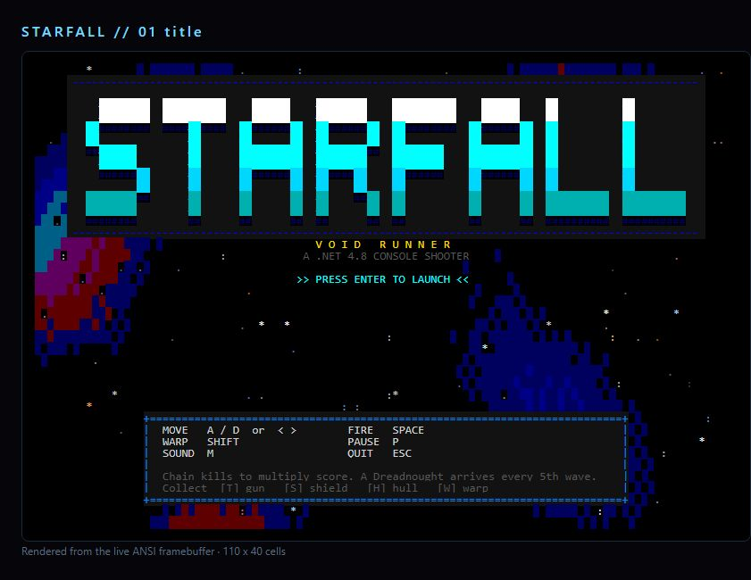
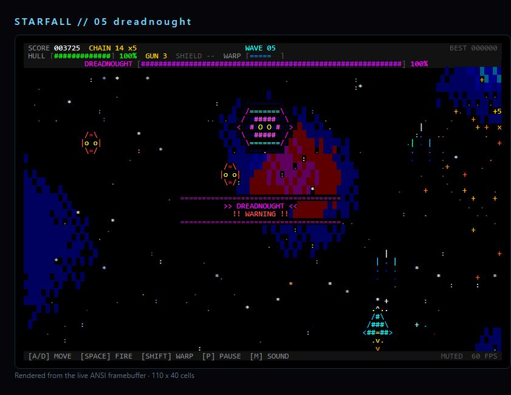
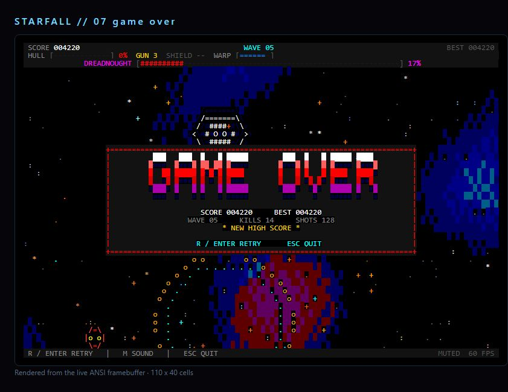

# STARFALL // Void Runner

A retro-arcade vertical space shooter that renders **entirely inside the Windows command
prompt** with ANSI / xterm-256 colour. It targets **.NET Framework 4.8** and uses **no
WinForms, no console-game frameworks, and no NuGet packages** — just a character-cell
framebuffer, a custom diff renderer and a fixed-step game loop.

You fly a fighter through a parallax starfield and drifting nebula gas, shoot upward at
asteroids, drones, hunters and a Dreadnought boss every fifth wave. Hyperspace
(`SHIFT`) stretches every star into a streak while the warp meter drains.

| Title | Dreadnought fight | Game over |
| --- | --- | --- |
|  |  |  |

*(The images are renders of the live ANSI framebuffer generated by `--record`; open the
`.html` files in `preview/` to see the captured frames at full fidelity.)*

## Play

```bat
build.cmd
build\Starfall.exe
```

Windows Terminal is recommended (truecolor + fast ANSI output), but the classic console
works too. Requires Windows 10/11 with .NET Framework 4.8 (it ships with Windows).
An 80x24 window minimum is recommended; the HUD adapts to smaller and larger windows.

### Controls

| Key | Action |
| --- | --- |
| `A` / `D` or `←` / `→` | move |
| `W` / `S` or `↑` / `↓` | slide up / down |
| `SPACE` (also `Z` / `J`) | fire upward |
| `SHIFT` | hyperspace boost (drain / recharge warp meter) |
| `P` | pause |
| `M` | mute / unmute the beeper |
| `R` | retry on game over |
| `ENTER` | launch / retry |
| `ESC` | quit |

### Rules

* Hull starts at 100. Enemy shots and collisions hurt; pickups repair and shield you.
* Pick up `[T]` to raise the gun level (up to 5-shot spread), `[S]` for a 2-hit shield,
  `[H]` for +30 hull, `[W]` to refill warp.
* Chain kills within 2.8 s of each other. The chain multiplies score up to **x6**.
* Waves last ~17 seconds and get denser. Every 5th wave a **Dreadnought** arrives with
  aimed spreads and radial bullet patterns, and enrages below 40% hull.
* The best score is saved to `%LOCALAPPDATA%\Starfall\best.txt`.

## Build

Two equivalent ways:

```bat
:: Option A - uses the in-box C# compiler and the official .NET Framework 4.8
:: reference assemblies when they are present in tools/net48refs (developer
:: checkout). Otherwise it compiles against the installed framework. No SDK.
build.cmd
```

The script compiles every file in `src/` against
`tools/net48refs/build/.NETFramework/v4.8` and writes `build\Starfall.exe`.
The output carries `TargetFrameworkAttribute(".NETFramework,Version=v4.8")` and
references only `mscorlib` and `System` — there is no `System.Windows.Forms`
reference anywhere.

```bat
:: Option B - with the .NET SDK (restores the net48 reference assemblies):
dotnet build -c Release
```

`Starfall.csproj` targets `net48` and sets `LangVersion` 5 so the source stays
compatible with the in-box compiler used by `build.ps1`.

### 32-bit / Win32

The game is pure managed IL with P/Invoke only to `kernel32`/`user32`; there is no
64-bit-specific code, so the default AnyCPU build also runs on 32-bit Windows. An
explicit Win32 build is available too:

```bat
:: -Platform anycpu (default) | x86 | x64, -OutFile optional
powershell -NoProfile -ExecutionPolicy Bypass -File build.ps1 -Platform x86 -OutFile build\Starfall32.exe
```

That produces a PE32 executable with the `32BITREQUIRED` CLR flag set; it runs under
WoW64 on 64-bit Windows.

## Diagnostics, headless demo and screenshots

```bat
build\Starfall.exe --help
build\Starfall.exe --selftest
build\Starfall.exe --record preview 1100
build\Starfall.exe --record small 600 80 24   :: frame count, width, height
```

* `--selftest` runs 40 automated checks covering the ANSI diff renderer, starfield and
  warp physics, movement/clamping, shooting, collisions, shield/hull damage, death,
  power-ups, boss spawning/attacks, wave escalation, chain scoring, particle bounds,
  determinism and render cost. Exit code 0 means all checks passed.
* `--record DIR [frames] [width] [height]` runs a deterministic autopilot headlessly and
  writes `.txt`, `.html` and `.ansi` captures of the title, combat, boss, warp and
  game-over screens. The HTML files are standalone and show the exact per-cell colours.

## How it works

* **`src/Screen.cs`** — a colour character framebuffer (char + 8-bit fg + 8-bit bg per
  cell) with a **diff renderer**: every frame it compares against the previous frame and
  emits only changed runs as absolute-cursor ANSI sequences. A static scene costs zero
  output. HTML export maps the same buffer through the xterm-256 palette.
* **`src/Starfield.cs`** — ~130 parallax stars across depth layers, twinkle, warp
  streaks, plus a slow procedural nebula painted as coloured background cells and
  dithered to keep it subtle.
* **`src/Game.cs`** — fixed-step combat simulation: waves, spawner, enemy behaviours,
  boss patterns, collisions, chain scoring, power-ups, particles, shockwaves, screen
  shake, HUD, title/pause/game-over presentations.
* **`src/Program.cs`** — console setup (virtual-terminal processing, window sizing,
  alternate key input), 60 Hz simulation with a 30 fps render cap, resize handling and
  clean terminal restore.
* **`src/Input.cs`** — `GetAsyncKeyState` for smooth held-key movement (a console gives
  no key-up events) plus `ReadKey` for one-shot keys.
* **`src/Audio.cs`** — non-blocking `Console.Beep` effects on a background queue.
* **`src/Bot.cs` / `src/Recorder.cs` / `src/SelfTest.cs`** — autopilot used by the demo
  capture and the test suite.

Measured on this machine: **~1.1 ms** per update + draw + ANSI diff at 110x40, with a
30 fps render cap (the game logic still simulates at 60 Hz).
